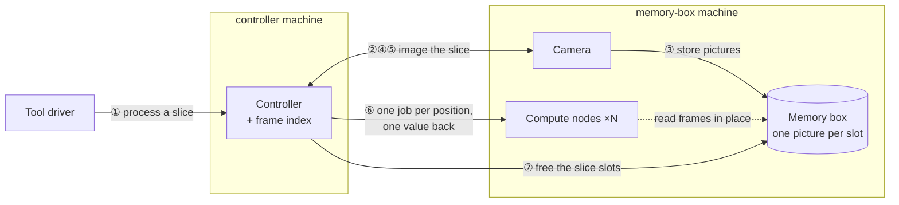

# Algorithm Controller

[](https://github.com/erancha/algorithm-controller/actions/workflows/ci.yml)

A design, with a working C++ implementation, for the controller of a wafer-inspection tool. The
tool photographs a wafer one slice at a time, a slice being a strip of dies (identical chips).
For each slice, the controller hands one job per frame-in-die position (the same spot on every
die) to a free compute node and gathers one number per position. A high number marks a spot
where one die differs from the rest, which is how a defect shows up. The design answers a
[system-design interview question](docs/problem.md).

## Overview

- The camera photographs a slice into a shared memory box. Each picture is stored once and never
  copied.
- The controller splits the slice into one job per frame-in-die position and sends each job to
  whichever compute node is free, so the nodes work in parallel.
- A node compares the frames of every die at that position and returns one number: near zero
  when the dies agree, high when one of them differs.
- Compute nodes join by starting up. A node that fails is dropped, and only the slice in flight
  is lost.
- The whole system runs locally as five processes, on simulated camera images with two planted
  defects.

## Tech stack

- **Language**: C++20
- **Calls between processes**: gRPC and Protobuf
- **Pixel sharing**: POSIX shared memory
- **Build and dependencies**: CMake and vcpkg
- **Tests**: GoogleTest, plus a bash end-to-end test
- **CI**: GitHub Actions

## Architecture

The controller can run on its own machine. The camera, the memory box and the compute nodes share
a second machine, where every process reads pictures straight from the memory box. Only small
messages, such as slice ids, slot numbers and results, cross the network.



The numbers ①–⑦ are the steps of one slice, in order. The controller–camera edge carries ②, ④
and ⑤; the dotted read happens inside ⑥.
[How a slice runs](docs/architecture.md#how-a-slice-runs) walks through every step.

Architecture continues from here: [docs/architecture.md](docs/architecture.md).

## Getting started

Needs a Linux shell, a C++20 compiler, CMake and vcpkg
([details](docs/development.md#prerequisites)). From the repo root:

```bash
export VCPKG_ROOT=~/vcpkg     # your vcpkg checkout; the first configure compiles gRPC and
                              # protobuf from source (several minutes, once)
./scripts/start.sh generate   # one-time: build and render the fixture images
./scripts/start.sh            # start the whole stack, run one slice, tear down
```

## Scripts

All live in `scripts/`; each prints its full usage with `--help`.

| Script | Purpose |
|---|---|
| `start.sh` | Build when sources changed, then run the whole pipeline, single services, or fixture generation. |
| `test.sh` | Build and run the test suite: every layer, or only the named ones. |
| `benchmark.sh` | Run `start.sh --frame-rate 0 --compute-ms 5` (simulated delays off) once per frame size, 256 to 2048, and report each run's time and how the work split across the compute nodes ([Measure](docs/development.md#measure)). |

## Details

- [Problem](docs/problem.md): the interview question, the terms, and what a slice looks like.
- [Architecture](docs/architecture.md): every part, how one slice runs, and the one-host process
  layout.
- [Component APIs](docs/component-apis.md): the signature and contract of each call in the
  architecture diagram.
- [Streaming dispatch](docs/streaming-dispatch.md): a deferred variant that overlaps imaging with
  compute.
- [Development](docs/development.md): build, run, test and measure locally.
- Component docs: [controller](src/controller/README.md), [camera](src/camera/README.md),
  [memory box](src/membox/README.md), [algorithm](src/compute_node/algorithm/README.md).

## License

Released under the MIT License. See [LICENSE](LICENSE).

---

More projects by the author: [github.com/erancha](https://github.com/erancha)
