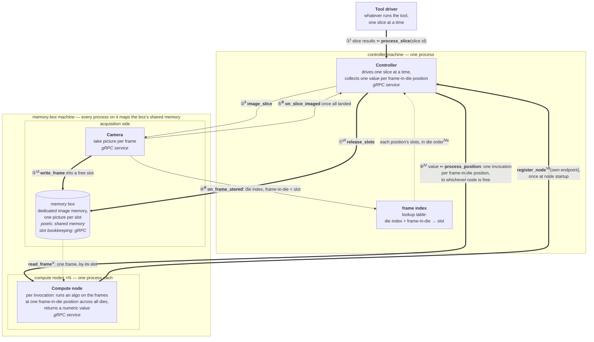

# Architecture

The design behind the [README](../README.md)'s Architecture section: every part, how one slice
moves through them, and how this implementation runs them on one host.
[Problem](problem.md) defines the terms; [component APIs](component-apis.md) gives each call's
signature.

## Diagram

Arrow style shows how a call behaves: **thick**, the caller waits for a reply; **thin**, a one-way
message; **dotted**, data that moves without a command.

### Reading the diagram

Two numberings tie the diagram to the code. Circled numbers (①–⑦) are the steps of one slice, in
order, one per solid arrow. Superscript roman numerals name the code blocks in
[component APIs](component-apis.md), and the arrow's **bold** function name heads that block. So
①Ⅰ reads "step 1, defined in block Ⅰ". A leading `x ⇐` names the call's return value.

Some arrows carry no step number. Dotted arrows carry data: the memory-box read is block Ⅴ, which
a node performs while serving ⑥, and the hop from the frame index to the controller builds each ⑥
invocation's slot list
([block Ⅳa](component-apis.md#ⅳa-from-lookup-table-to-invocation)). Registration (Ⅶ) happens once
per node at startup, before any slice exists, so it sits outside the ①–⑦ cycle.

Solid arrows travel over gRPC, with one exception: ③'s pixels land in the memory box through
shared memory, and only its slot bookkeeping is a gRPC call. The dotted read (Ⅴ) is pure shared
memory as well. Pixels therefore never cross gRPC, and every network message carries only
identifiers and numbers.

## Parts

- **Tool driver**: whatever runs the inspection tool. It calls `process_slice` once per slice.
- **Controller**: one process on its own machine. It runs one slice at a time and collects one
  value per frame-in-die position; [src/controller](../src/controller/README.md).
- **Frame index**: the controller's lookup table from (die index, frame-in-die position) to slot,
  filled as pictures land.
- **Camera**: photographs a slice and writes each picture into a free slot;
  [src/camera](../src/camera/README.md).
- **Memory box**: a bank of picture-sized slots in shared memory on the memory-box machine. Every
  process on that machine maps it; [src/membox](../src/membox/README.md).
- **Compute nodes**: separate processes on the memory-box machine, any number of them. Each runs
  the algorithm for one position at a time;
  [src/compute_node/algorithm](../src/compute_node/algorithm/README.md).

## How a slice runs

1. The tool driver calls `process_slice` ① with a slice id.
2. The controller asks the camera to photograph the slice with `image_slice` ②.
3. Each picture lands in a free slot ③. The camera reports which die and position that slot
   holds ④, and the controller records it in the frame index.
4. When the camera reports the whole slice imaged ⑤, the controller sends one invocation per
   position ⑥ to whichever compute node is free. An invocation carries that position's slots, one
   per die, and each node runs one invocation at a time.
5. The node reads those frames straight from the memory box, runs the algorithm on them, and
   replies with one number. The controller stores it at the position's index in the results.
6. When every position has replied, the controller releases the slice's slots ⑦, so the next
   slice's pictures can use them, and returns the results as the reply to ①.

## Shared mechanisms

- **Node registration.** The controller is never configured with node addresses. Each compute
  node announces its own address once at startup (Ⅶ), and the controller dispatches to whichever
  nodes have registered so far, so adding a node means starting it. A node whose invocation fails
  or times out is dropped and returns by registering again. A failed node costs only the slice in
  flight. The [controller README](../src/controller/README.md) has the details.
- **Deadlines.** Every call carries a deadline, so a stalled peer surfaces as an error instead of
  a hang.
- **Whole-slice dispatch.** The first invocation waits until the whole slice is imaged.
  Dispatching each position as soon as its frame has landed in every die would overlap imaging
  with compute; [streaming dispatch](streaming-dispatch.md) sketches that and keeps it out of this
  design.
- **Compute nodes on other machines.** OPEN — not yet implemented (#1).

## Storage

There is no database. A slice's state lives in two places, both gone once the slice ends:

- **Memory box**: one POSIX shared-memory segment holding a fixed number of picture-sized slots. A
  slot is a byte offset into the segment. The [membox README](../src/membox/README.md) covers how
  slots are allocated, read and released.
- **Frame index**: in the controller's memory. It holds slot numbers only, never pixels.

## Running on one host

This implementation puts both machines on one host. `scripts/start.sh` launches each binary on its
own localhost port, and every process maps the same POSIX shared-memory segment.

### Process topology

Five binaries, each a separate OS process. Names, roles and step numbers match the
[diagram](#diagram):

| binary           | role (diagram)          | serves (gRPC)                     | calls |
|------------------|--------------------------|-------------------------------------|-------|
| `tool-driver`    | Tool driver              | —                                    | ① `ProcessSlice` |
| `controller`     | Controller + frame index | `ProcessSlice` (Ⅰ), `RegisterNode` (Ⅶ) | ② `ImageSlice`, ⑥ `ProcessPosition`, ⑦ `ReleaseSlots` |
| `camera`         | Camera                   | `ImageSlice` (Ⅱ, streams Ⅲ back)     | ③ `write_frame` (libmembox) |
| `compute-node`   | Compute node (×N)        | `ProcessPosition` (Ⅳ)                | Ⅴ `read_frame` (libmembox), Ⅶ `RegisterNode` |
| `membox-manager` | memory box bookkeeping   | `AllocSlot`, `ReleaseSlots` (Ⅵ)      | — |

### Memory footprint (dev scale)

Resident memory per process, measured with `ps -o rss=` on a running 20-die slice (512 slots,
64 KB frames, 3 compute nodes):

| process                   | resident    | why |
|----------------------------|-------------|-----|
| `membox-manager`            | ~27 MB      | gRPC runtime floor; the free list holds slot numbers only |
| `controller`                 | ~28 MB      | gRPC runtime floor; the frame index holds slot numbers only |
| `camera`                     | ~58 MB      | gRPC floor plus PGM file buffers while streaming a slice |
| `compute-node` (×3)           | ~37 MB each | gRPC floor; frames are read zero-copy from the mapped segment |
| shm segment (512 × 64 KB)     | 32 MB, once | mapped by every process; the OS accounts it once, not per-mapper |

Two figures do not grow with frame size:

- **Controller memory.** The frame index stores only `uint64_t` slot numbers, so larger frames
  leave it unchanged. Only more dies or positions grow it, by a few bytes per entry.
- **Compute-node memory.** `read_frame` (Ⅴ) returns a view into the shared mapping, so the pixels
  a node reads live once, in the mapping, and never in the node's own heap.

## Codebase structure

| Directory | What it holds |
|---|---|
| `src/proto/` | `inspection.proto`, the gRPC contract between all processes |
| `src/controller/` | the `controller` binary: frame index, node pool, dispatch |
| `src/camera/` | the `camera` binary and the fixture generator |
| `src/membox/` | `libmembox`, linked by camera, controller and compute node, and the `membox-manager` binary |
| `src/compute_node/` | the `compute-node` binary; `algorithm/` holds the scoring algorithm |
| `src/driver/` | the `tool-driver` binary, which plays the inspection tool |
| `src/common/` | command-line flag parsing and PGM image reading and writing |
| `tests/` | unit and gRPC service tests, plus `e2e.sh` for the five-process run |
| `scripts/` | build, run, test and measurement entry points; see [development](development.md) |
