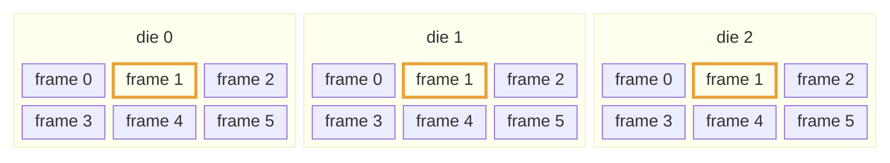

# Problem

The design question this repo answers, the terms the other documents use, and what a slice looks
like. Part of the [architecture](architecture.md) documentation; the [README](../README.md) is the
entry point.

## Problem statement

*"Design the controller of a wafer-inspection tool that photographs a wafer slice by slice —
[a slice is a strip of dies, and each die is captured as several frames](#slice-anatomy).
Every picture lands in one slot (AKA offset) of a shared memory box, and from then on a frame is
named by its slot, never copied. The controller, one slice at a time, splits the slice's work
across a group of compute nodes; each invocation runs an algorithm on all the frames that share
one frame-in-die position (i.e. the same frame position in every die) and returns a single
numeric value; the controller then gathers those values: one per frame-in-die position, so
[dies of six frames](#one-slice-diagram) yield six values for the slice."*

## Terminology

- **die**: one copy of the chip's circuit; a wafer carries many identical dies.
- **slice**: a strip of dies.
- **frame**: one camera picture covering part of a die. A die is too large for one shot, so each
  die is imaged as a [grid of frames](#one-slice-diagram).
- **frame-in-die position**: a frame's place in that grid. Dies are copies of one circuit, so a
  position is the same physical region in every die.
- **slot**: one picture-sized cell of the shared memory box, identified by its numeric offset
  into the box (which is why the problem also calls it an "offset").

## Derived requirements

- As each picture lands, the acquisition side reports its placement to the controller: which
  die index and frame-in-die position it captures, and the slot that holds it.
- The compute nodes are separate processes on the memory-box machine, and any node can serve any
  invocation.
- The frames at one position, one per die, are the natural input for comparing dies against each
  other.

## Slice anatomy

An example slice: three dies, each imaged as six frames. Every frame-in-die position groups one
frame from each die into the input of a single invocation, which returns one value for that
position. The highlight shows one such group, frame 1 of every die. Six positions, so this slice's
[`process_slice`](component-apis.md#ⅰ-tool-driver--controller-①) reply holds six values.

The diagram is a miniature. At a realistic scale, a 4096×4096 8-bit sensor makes each frame
16 MB. With a 2 mm field of view, a 10 mm die is a 5×5 grid of 25 frames, and a 20-die slice
fills about 8 GB of the memory box. That load is why the design uses dedicated image memory and
moves pixels only once, from camera to memory box.

### One slice diagram

